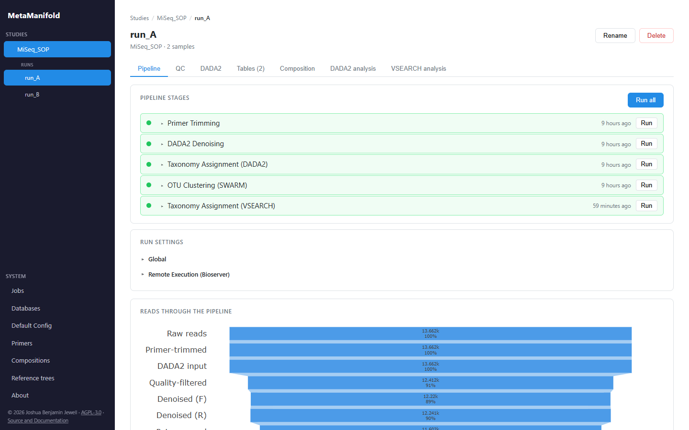
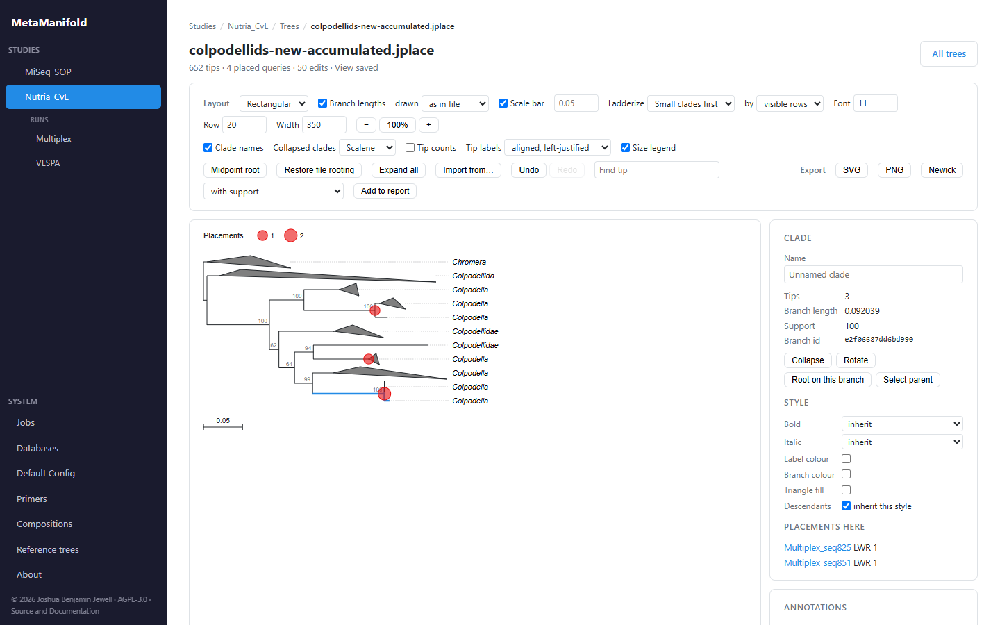
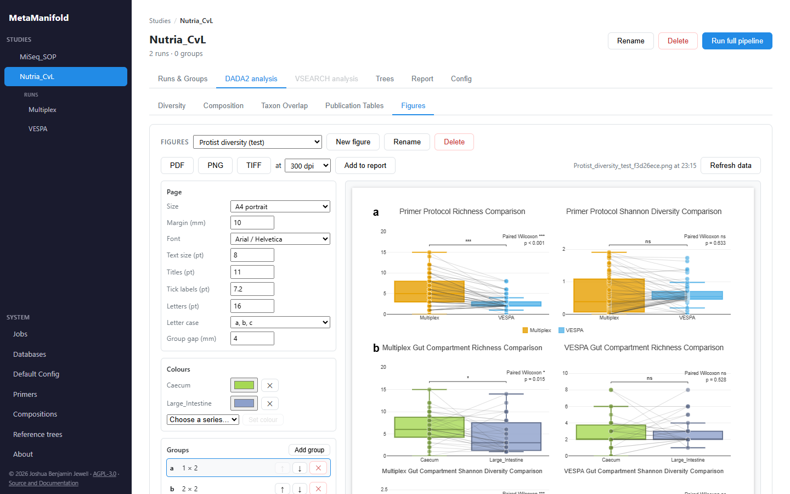

<!-- SPDX-FileCopyrightText: 2026 Joshua Benjamin Jewell -->
<!-- SPDX-FileCopyrightText: 2026 Jonathan D.A. Jewell (hyperpolymath) <j.d.a.jewell@open.ac.uk> -->
<!-- SPDX-License-Identifier: CC-BY-SA-4.0 -->

# MetaManifold

[](#licence)
[](https://doi.org/10.5281/zenodo.23464265)
[](https://julialang.org)
[](https://www.r-project.org)
[](https://github.com/JoshuaJewell/MetaManifold-WebUI/actions/workflows/ci.yml)
[](https://codecov.io/gh/JoshuaJewell/MetaManifold-WebUI)

MetaManifold is a self-hosted web application for amplicon metabarcoding, built around eukaryotic communities. It runs DADA2 and swarm side by side, assigns taxonomy against PR2 or another reference database, places ASVs on reference trees, and carries the results through statistics to publication figures. DADA2 and phylogeny stages can run on a remote server over SSH.

<p align="center">
  
</p>

## What you can do with it

- **Keep host and target signal apart.** Sort ASVs and OTUs into editable categories such as host, helminths, protozoa, fungi and plants, then filter or exclude them throughout the analysis.
- **Compare denoising and clustering directly.** DADA2 ASVs and swarm OTUs come from the same trimmed reads, with vsearch and DADA2 taxonomy in one table.
- **Change a setting without repeating the run.** Configuration cascades from instance to study, group and run. Stages affected by a change are flagged stale, and only those stages rerun.
- **Place sequences on a tree and work with the result.** Build a reference tree once, place ASVs from any study on it, and inspect or export the placement in an interactive viewer.
- **Test differences between communities.** Alpha diversity with significance testing, NMDS, PERMANOVA with PERMDISP, and negative-binomial or CLR differential abundance between two conditions. A test that could not run is reported as such, never as a null result.
- **Finish in the same place.** Lay out multi-panel figures at journal column widths, build publication tables, and download charts, tables and trees as one report.
- **Show how a result was made.** Each run records the configuration, tool versions and database hashes behind every stage in `attestation.yml`. Julia, R and tool versions are pinned.

<p align="center">
  
</p>

<p align="center">
  
</p>

## Is it right for your project?

| | |
| --- | --- |
| **Reads** | Illumina-style paired-end amplicons. PacBio and Oxford Nanopore reads are not supported, and neither is shotgun metagenomics. |
| **Markers and references** | Designed for 18S with PR2, and configurable for other databases. Bacterial 16S will run, but the eukaryote-specific categories and filters will do little for it. |
| **Differential abundance** | Two conditions at a time, using a negative-binomial GLM or Welch's t-test on centred log-ratios. There are no multi-factor model formulas, and ANCOM-BC is not included. |
| **Where it runs** | Linux, and Windows through WSL. macOS is supported by the installer but not routinely tested. DADA2 and phylogeny stages can be sent to one server over SSH. There is no Slurm or other scheduler integration, and no official container image. |
| **Who can use an instance** | Designed for one user or a trusted group. The server binds to `127.0.0.1` by default and has no login or user accounts, so do not expose it directly to the internet. |

## Installation

```bash
git clone https://github.com/JoshuaJewell/MetaManifold-WebUI.git
cd MetaManifold-WebUI
bash install.sh
```

`install.sh` installs Julia if needed, then fetches the pipeline tools and restores the pinned R environment. R must already be installed, and the installer tells you what to do if it is not. See the [installation guide](docs/guide/installation.md) for details, including machines that send heavy stages to a server.

## Quick start

1. Put paired-end `.fastq.gz` files in `data/MyProject/run_A`.
2. Run `bash start.sh`.
3. Open http://localhost:8080.

From there you can set up the study, configure and launch the pipeline, and explore the results in your browser.

## Documentation

- [Pipeline and analysis](docs/guide/pipeline.md): the stages and the statistics available
- [Web interface](docs/guide/web-interface.md): a tour of each view
- [Configuration](docs/guide/configuration.md): databases, primers, each pipeline stage, remote execution and filters
- [Installation and deployment](docs/guide/installation.md): prerequisites, server options and split deployments
- [Input data and outputs](docs/guide/data-and-outputs.md): expected file layout and what each run produces
- [Development](docs/guide/development.md): REST API, tests and architecture
- [Contributing](CONTRIBUTING.md) and [release notes](docs/release-notes/)

## Third-party tools

This project orchestrates the following tools. Each is fetched from its upstream source by `install.sh` and is subject to its own licence; no third-party binaries are included in this repository.

| Tool                                            | Licence | Source                  |
| -------------------------------------------------| ---------| -------------------------|
| [cutadapt](https://github.com/marcelm/cutadapt) | MIT     | PyPI                    |
| [FastQC](https://github.com/s-andrews/FastQC)   | GPL v3  | Babraham Bioinformatics |
| [MultiQC](https://github.com/MultiQC/MultiQC)   | GPL v3  | PyPI                    |
| [DADA2](https://benjjneb.github.io/dada2/)      | LGPL v3 | Bioconductor            |
| [swarm](https://github.com/frederic-mahe/swarm) | GPL v3  | GitHub Releases         |
| [vsearch](https://github.com/torognes/vsearch)  | GPL v3  | GitHub Releases         |
| [cd-hit](https://github.com/weizhongli/cdhit)   | GPL v2+ | GitHub Releases / apt   |
| [MAFFT](https://mafft.cbrc.jp/alignment/software/) | BSD  | Source / apt            |
| [trimAl](https://github.com/inab/trimal)        | GPL v3  | GitHub Releases         |
| [IQ-TREE](https://github.com/iqtree/iqtree3)    | GPL v2  | GitHub Releases         |
| [RAxML](https://github.com/stamatak/standard-RAxML) | GPL v3 | Source / apt         |
| [gappa](https://github.com/lczech/gappa)        | GPL v3  | Source                  |

## Citation

If you use MetaManifold in your work, please cite it through its Zenodo DOI,
[10.5281/zenodo.23464265](https://doi.org/10.5281/zenodo.23464265), which covers
every version. `CITATION.cff` holds the full metadata (GitHub's "Cite this
repository" button reads it) and lists the tools MetaManifold runs, which should
be cited as well.

## Acknowledgements

This pipeline draws on the following prior work:

- **Frédéric Mahé**: [Fred's metabarcoding pipeline](https://github.com/frederic-mahe/swarm/wiki/Fred's-metabarcoding-pipeline) informed the overall workflow architecture, namely the sequencing of primer trimming, `swarm.jl`, vsearch-based taxonomy assignment, and the final table merge/filter stages.
- **Benjamin J. Callahan _et al._**: [DADA2 tutorial](https://benjjneb.github.io/dada2/tutorial.html), used under [CC BY 4.0](https://creativecommons.org/licenses/by/4.0/), on which `dada2.jl` and its modules are based.

The following people contributed code to this project:

- **Jonathan D.A. Jewell** ([@hyperpolymath](https://github.com/hyperpolymath)): the differential abundance analysis, statistical-correctness fixes to the omnibus tests and PERMANOVA, server hardening, CI and installer improvements, and the machine-checked Agda proofs in `proofs/agda/`, which he maintains.

The following colleagues at the **Department of Parasitology, Charles University** (Faculty of Science, BIOCEV, Vestec, Czech Republic) contributed to this work:

- **Mgr. Jiří Novák** ([@novakj96](https://github.com/novakj96)) (supervisor): scripts from which several modules and configurations were adapted.
- **doc. Mgr. Vladimír Hampl**: provided laboratory access and resources.
- **Mgr. Paulína Pristašová**: <3.

## Licence

Copyright © 2026 Joshua Benjamin Jewell and contributors.

MetaManifold as shipped is licensed under the [GNU Affero General Public License v3.0 or later](LICENSE), because the server is. Individual files carry their own licence in an SPDX header, or in `REUSE.toml` if they cannot hold a comment:

| Files | Licence |
|---|---|
| Server: `src/server`, `scripts/serve.jl` and the tests that exercise them | AGPL-3.0-or-later |
| Core, pipeline, analysis, frontend and tooling | MPL-2.0 |
| Documentation, including this README | CC BY-SA 4.0 |
| Lockfiles and generated manifests | CC0-1.0 |

The licence texts are in [`LICENSES/`](LICENSES). The example reads in `data/MiSeq_SOP` come from the [mothur MiSeq SOP](https://mothur.org/wiki/miseq_sop/) (accessed 2026-11-07; Kozich et al. 2013, [doi:10.1128/AEM.01043-13](https://doi.org/10.1128/AEM.01043-13)), used under CC BY 4.0.
