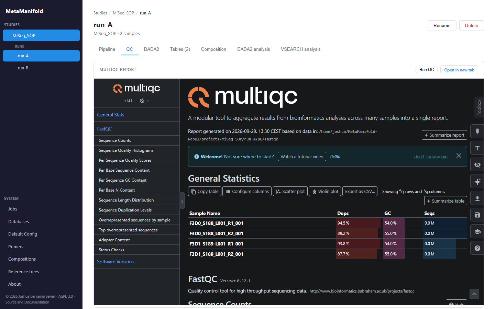
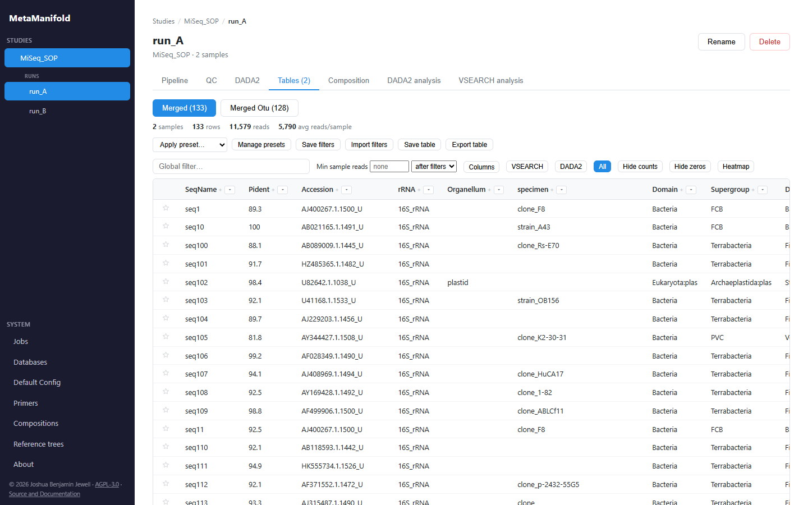
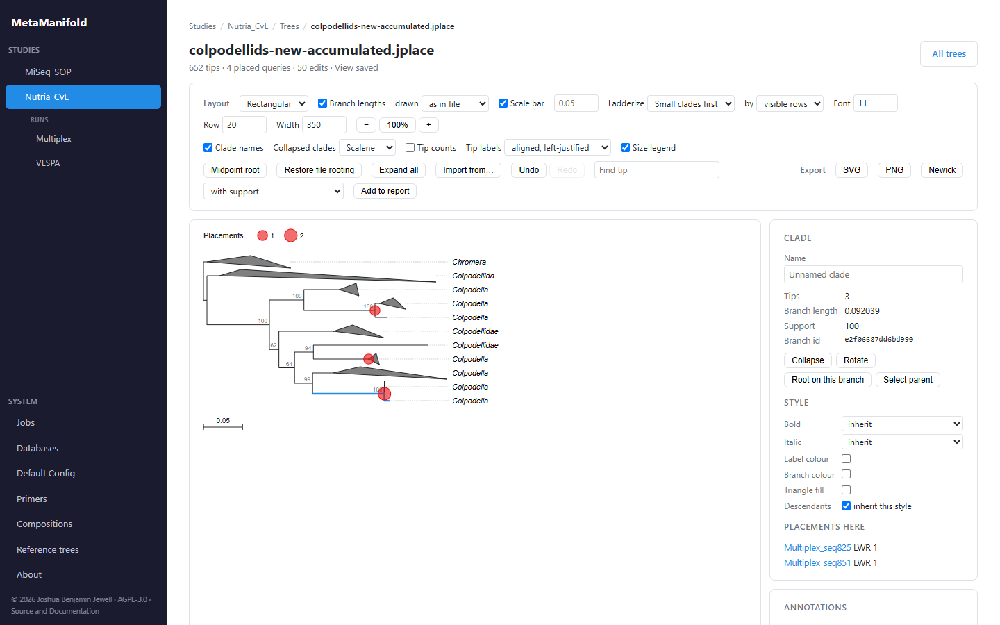
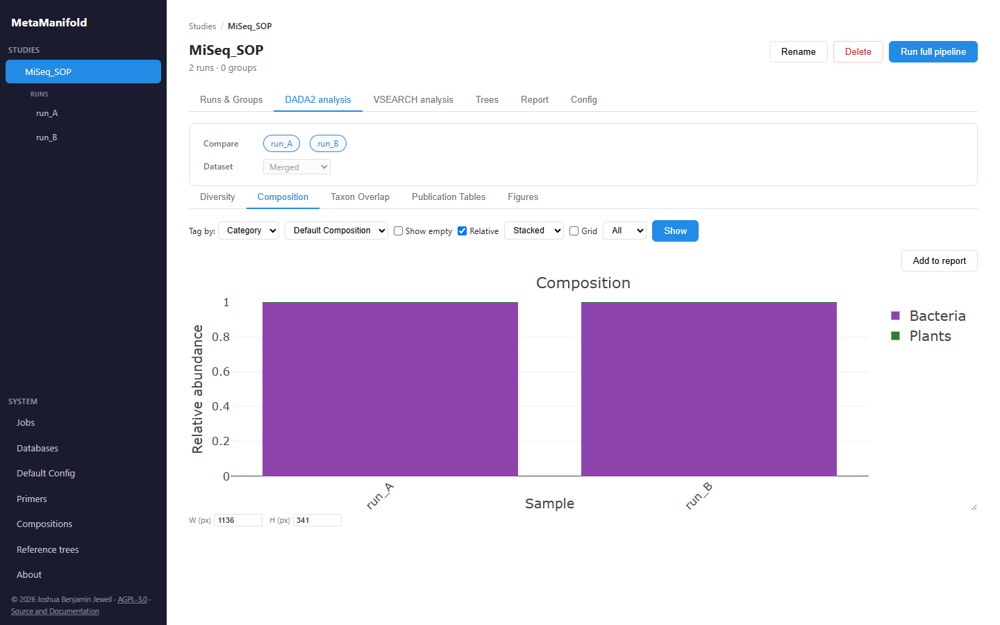
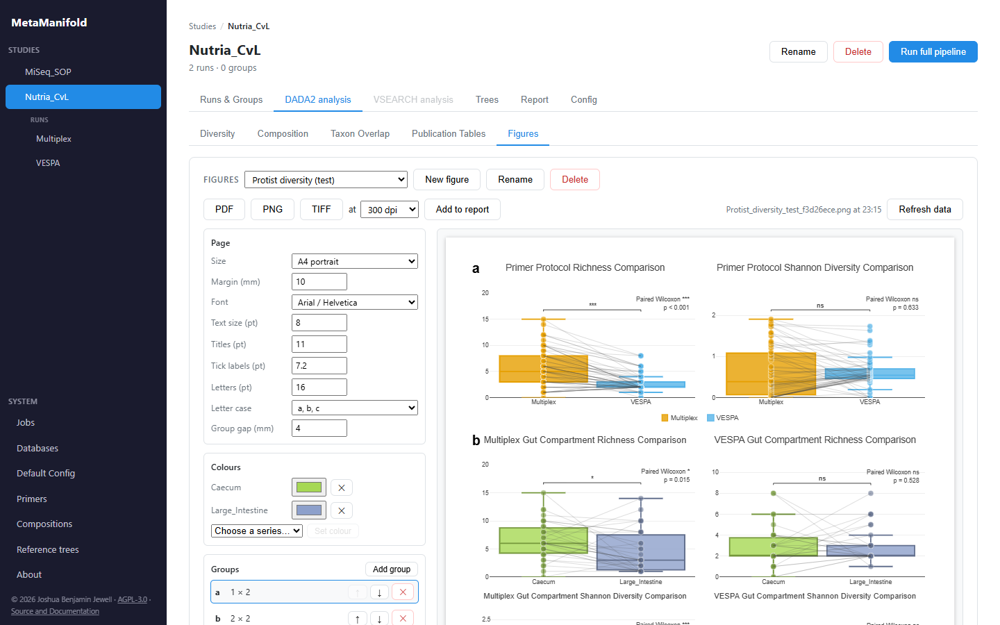

<!-- SPDX-FileCopyrightText: 2026 Joshua Benjamin Jewell -->
<!-- SPDX-FileCopyrightText: 2026 Jonathan D.A. Jewell (hyperpolymath) <j.d.a.jewell@open.ac.uk> -->
<!-- SPDX-License-Identifier: CC-BY-SA-4.0 -->

# Web interface

The browser interface is the primary way to drive MetaManifold. Beyond creating studies and launching runs, it offers the following:

### Editing configuration

Every pipeline setting can be edited in the UI without touching a YAML file. Configuration is presented as collapsible accordion sections (study design, primer trimming, DADA2 denoising and taxonomy, OTU clustering, analysis) and can be set at any level of the cascade: the instance-wide defaults, a study, a group, or an individual run. Edits at a finer level override coarser ones (see [Configuration](configuration.md) for the cascade rules). When a setting changes, the affected pipeline stages are flagged as stale, with a tooltip listing the changed keys and their level.

### Pipeline runs and outputs

A run's page is the working surface for that run. It is where the run-level configuration above is edited, where the full pipeline or any individual stage (including the DADA2 substages) is launched, and where each stage's status is shown. Long-running jobs report progress live through a server-sent event stream, and the jobs panel lets you watch or cancel them. As stages complete, their outputs become available through the views that follow: quality reports, the results table and composition.

### QC

Raw-read QC (FastQC aggregated by MultiQC) is embedded in each run's page with a rerun control. The DADA2 quality, denoising, merging and taxonomy diagnostics sit beside their stage settings.

  

### Results explorer

Each run's merged taxonomy-and-count table, and any derived tables, can be browsed. The table supports per-column filtering (text search, numeric range, include/exclude lists) and a global text filter, column sorting, configurable pagination, and column visibility toggles including taxonomy-source presets (VSEARCH-only, DADA2-only, or all) and a switch for the per-sample count columns. Sequences carry BLAST links, and OTU rows can be expanded to their constituent sequences. Frequently used filters can be saved as named presets and reapplied; filtered tables can be saved back into the run or exported as `.xlsx`.

  

### Phylogenetic placement

Reference trees (under SYSTEM) are built once from uploaded reference sequences
and used by any study. A study's Trees tab places its ASVs on one of them: pick
runs and, for pooled runs, subgroups, a results table, a rank and taxa, or upload
a FASTA. Each step shows where it runs, its state and its log, and the align and
trim steps show a QC view of the alignment. A finished placement adds the
reference tree, the placement jplace and the accumulated jplace to the study's
tree list. See
[Configuring phylogenetic placement](configuration.md#configuring-phylogenetic-placement-phylogeny-in-pipelineyml).

### Tree viewer

Newick and jplace files in a study's tree list open in an interactive viewer:
rectangular or circular layouts, rerooting, ladderizing, collapsing and naming
clades, per-clade colours and fonts, placement symbols sized by count, and
support values carried over from another tree. The view is saved beside the
tree and exports as SVG, PNG or Newick. Reference trees open in the same viewer
from the library page.

  

### Composition

The composition view classifies each ASV/OTU into a biological category and renders per-sample or pooled stacked bar charts. Category sets live in `config/composition.yml` (the bundled `default` set covers protozoa, helminths, fungi, host, plants, and invertebrates); each category references a named taxonomic filter from the `filters:` library in that same file. Both are editable from the Compositions page under SYSTEM in the sidebar. A category summary precedes the chart, and a quality filter can cap the number of unresolved taxonomic placeholders admitted.

  

### Differential abundance

In a study's analysis workspace, select two conditions (runs or pooled-run
subgroups), a results table and a shared taxonomic rank. The first condition
is the reference. Counts are aggregated by taxon after applicable
`analysis.exclude_categories` filters. This workspace does not pass sample
read-count bounds to the differential-abundance request, so those bounds do
not exclude samples from this analysis.

All `analysis.differential` options below (`method`, `offset`, `dispersion`,
`min_prevalence`, `replacement_delta` and `mn_reference_taxon`) are resolved
at study scope.
Set them in the study configuration; group and run overrides are not used
by this endpoint, including when called from a group Analysis workspace.

`analysis.differential.method` chooses the method:

- `nb_glm` (default): a negative-binomial GLM per taxon using `MASS::glm.nb`,
  with a library-size offset. The effect is log2 fold change; positive values
  indicate greater abundance in the second condition. `offset` selects `tss`
  (default) or `rle` scaling. `dispersion` selects the fits and the test:
  `glm_nb` (default) fits `MASS::glm.nb` per taxon with its own
  maximum-likelihood theta and Wald-tests the group coefficient; `glmGamPoi`
  fits one `glmGamPoi::glm_gp` across the taxa passing `min_prevalence`,
  sharing a dispersion trend across them, and reports `glmGamPoi::test_de`'s
  quasi-likelihood F-test. Under `glmGamPoi` the p-value comes from that
  F-test, the standard error is `test_de`'s `lfc_se`, and theta is each
  taxon's own estimate before shrinkage. It requires the pinned glmGamPoi R
  package and is refused for `clr_welch`.
- `clr_welch`: Welch's t-test on centred log-ratios after multiplicative zero
  replacement with `zCompositions::cmultRepl`. The effect is a CLR difference,
  not a fold change. `replacement_delta` controls the replacement fraction
  (default 0.65); `offset` is not used.
- `multinomial` and `dirichlet_multinomial`: one joint model of every
  sample's composition, fitted by `MGLM::MGLMreg.fit` (`dist = "MN"` or
  `"DM"`) and conditioned on each sample's read total, so there is no offset
  and no zero replacement. Every effect is the log2 fold change of a taxon's
  ratio to a reference taxon, which `mn_reference_taxon` names; empty (the
  default) uses the fitted taxon with the most reads. The reference row has
  status `reference` and no test. A taxon with no reads in every sample of one
  group has no finite estimate, so it is reported as failed and left out of
  the composition. The multinomial has no overdispersion, so its standard
  errors are too small when samples differ by more than sampling explains.
  The Dirichlet-multinomial lets each group's mean composition and
  overdispersion differ, needs at least 2 samples in each group, and reports
  each group's `theta` (0 is the multinomial). When a group shows no
  overdispersion its concentration has no finite estimate. The rows are then
  marked `boundary` and keep their statistics, because a log-ratio contrast
  does not depend on that concentration; or MGLM refuses the fit and the
  refusal names the flat group. Only when both groups are flat do the
  estimates equal the multinomial's, and only then does the note point to
  `multinomial`. At most 1000 taxa enter one
  fit. These methods need the pinned MGLM R package.

For every method, `min_prevalence` (default 0) filters taxa by the fraction of
samples with nonzero counts. Benjamini–Hochberg adjustment includes only taxa
that produced a p-value. Failed or filtered taxa have no substitute p-value;
inspect their status and note in the results table. Invalid input or an
unavailable required R package produces an explicit error.

Implementation and reference tests: `src/analysis/differential.jl`,
`src/server/routes/analysis.jl`, and `test/unit/test_differential.jl`.

### Figures and report

The Figures tab lays analysis charts out on a page (A4, letter or a journal
column width), in lettered groups of panels with shared colours, fonts and
sizes, and exports it as PDF, PNG or TIFF at a chosen resolution. The
Publication Tables tab builds one table at a time: rows of taxa at a rank or of
categories from a Compositions set, columns of runs, sub-groups or samples, and
any of ASVs, reads and percentage per column, with an optional difference
between two sub-groups. A table can be copied for Word or downloaded as `.xlsx` or
`.csv`. Charts, figures, tables and trees can be added to the study's Report tab,
which downloads them together as one ZIP with a captions file.

  

